# Meet Standup Turn

For daily standups in **Google Meet** where people speak in **alphabetical order**.

Meet always puts you at the top of the People list, so you have to work out who is before you.
This Chrome extension shows it in a small card in the call:

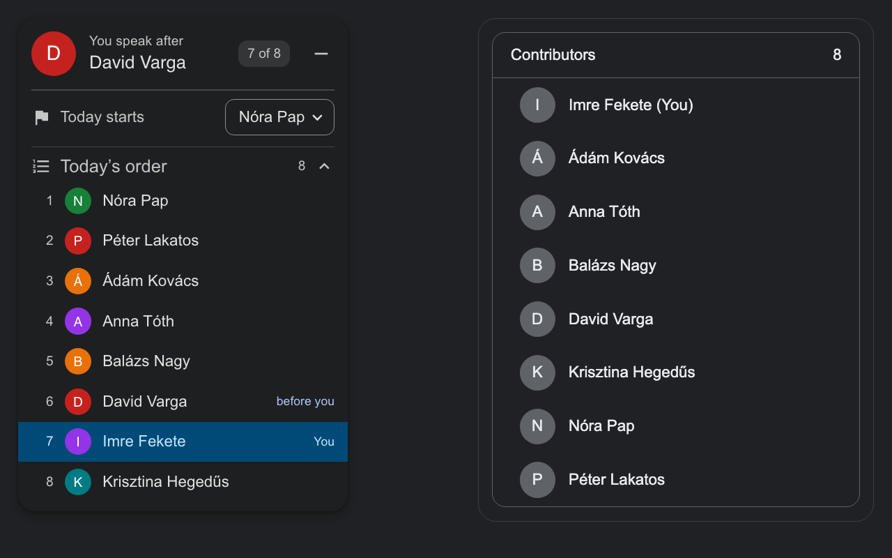

- **You speak after David Varga**: the person alphabetically before you among the people in the call.
- **7 of 8**: your place in today's order (shown when "Today starts" is set).
- **Today starts**: optional. Pick it once; on the next days the next person alphabetically starts.
- **Today's order**: the whole numbered list, starting with today's first speaker, you highlighted.

No account, no setup, no team list. Names come from the call and never leave your browser.

## Features

- Shows **after whom you speak** in an alphabetical standup, live, in the Meet call.
- **Works on its own**: no need to open the People panel; the card appears a second after you join.
- **Updates live** when people join or leave (late joiners, two people with similar names, someone dropping out).
- **Who starts today** (optional): pick once, then it rotates alphabetically every weekday by itself.
  People who are absent are skipped; days you missed are caught up.
- **Numbered speaking order** starting with today's first speaker, with you and the person before you marked;
  teammates who aren't in the call are shown greyed in their place.
- **Who is speaking** (beta): "Anna is speaking · 3 before you", "you're next", and a live marker in the order.
- **Exceptions**: mark the person leading the meeting as **Speaks last** (never starts, always at the end)
  and guests as **Not in standup** (left out of the order).
- **One team, many links**: the rotation belongs to the team, not to one Meet link. A new link for the same
  standup is recognised by who is in the call.
- Handles Meet's quirks: your own name pinned on top, "Merged audio" groups from meeting rooms,
  the same account joined from two devices, accents in names (Dávid / David).
- **Looks like Meet**: dark Material card, Meet-style menu, can be minimized to a round button.
- **Private**: no account, no server, no analytics; data stays in your browser.
- **Toolbar window**: click the icon to see update status, your standups (who starts today and next time,
  links, people) and fix or forget them. The icon shows **↑** when an update is waiting.
- **Update notice** in the card, and a **Reload extension** button once the new files are downloaded.

## Install

**From the Chrome Web Store (recommended, updates itself):**
[Meet Standup Turn](https://chromewebstore.google.com/detail/meet-standup-turn/oacbihellcgjjgcmcbhgjdmjncpooehe) → **Add to Chrome**.
Then join a Meet call; the card appears top left.

Already installed from the folder? Remove that copy in `chrome://extensions` first, then install from the store.
The store copy starts with empty data: pick today's starter and set the exceptions once more.

### From source (developers)

You need Chrome (or another Chromium browser: Edge, Brave, Arc).

**1. Get the files**

With git (recommended, makes updates one command):

```bash
git clone https://github.com/ibro-makhmudov/meet-standup-turn.git ~/meet-standup-turn
```

Without git (no account needed): download **[meet-standup-turn-main.zip](https://github.com/ibro-makhmudov/meet-standup-turn/archive/refs/heads/main.zip)**
and unzip it somewhere you'll keep it (not in Downloads if you clean that folder). This link always gives the latest version.

**2. Load it into Chrome**

1. Open `chrome://extensions` (paste it into the address bar).
2. Turn on **Developer mode** (switch in the top right corner).
3. Click **Load unpacked** (top left) and choose the `meet-standup-turn` folder.
4. "Meet Standup Turn" appears in the list. Optional: pin it from the puzzle icon in the toolbar.

**3. Join a Meet call**

The card appears in the top left corner a second or two after you join.
Don't delete or move the folder: Chrome runs the extension from it.

## Using it

### Your turn

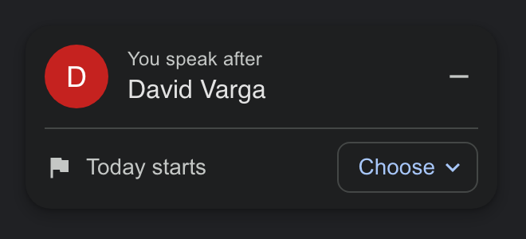

That's all you need: when David finishes, it's you. The card updates when people join or leave.

To read the names, the extension opens Meet's People panel for a moment when you join
(you may see it flash once) and closes it again. That happens at most once per call: Meet keeps the list up to date in the page afterwards. It never does this while chat or another side panel is open.

### Who starts today (optional)

If your team rotates the first speaker every day, click **Choose** and pick today's first speaker:

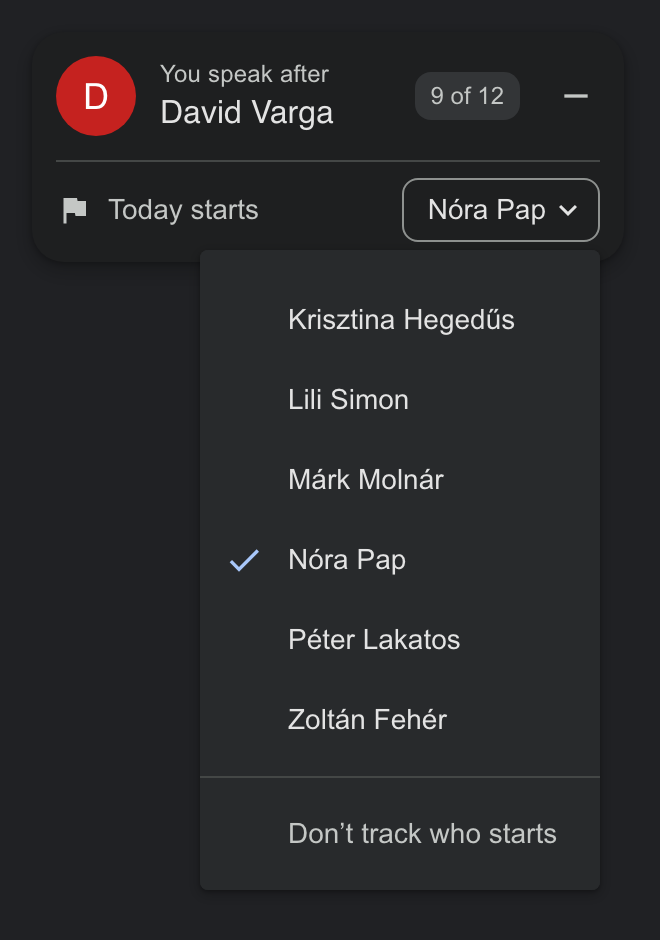

From then on:

- the card shows your place in today's order;
- on the next standup day, the **next person alphabetically** starts, and so on around the list;
- people who are not in the call are skipped; weekends don't count;
- after the call has run for 3 minutes, today's starter is remembered, so the rotation continues by itself;
- if you missed some days, those days are skipped over (one person per weekday). If the guess is wrong, just pick the right person.

Pick **Don't track who starts** at the bottom of the menu to turn it off.

When it's you:

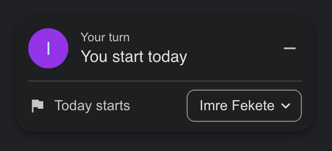

### Today's order

Click **Today's order** to see everyone, numbered, starting with today's first speaker.
You are highlighted and the person before you is marked. Without a chosen starter it shows the plain A–Z list.

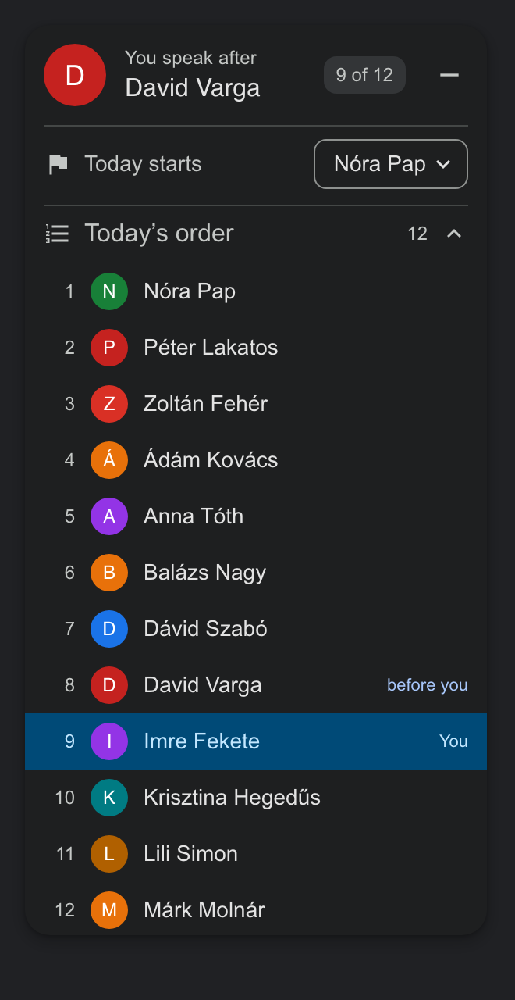

### Who is speaking (beta)

The card shows who is talking and how many people are left before you; the speaker is marked in Today's order:

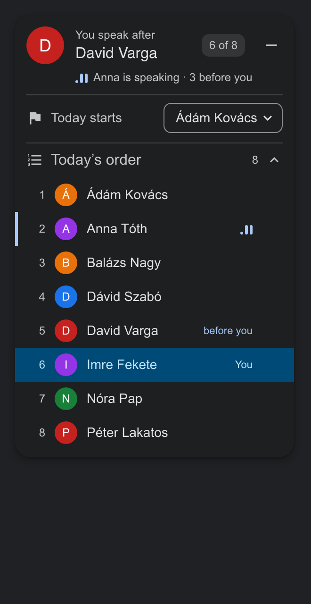

It reads Meet's sound indicator next to each person. In a standup everyone but the speaker is muted, so this works well;
someone who stays unmuted in a noisy room can be taken for the speaker for a moment. After the speaker stops,
they stay shown as "spoke last" for a few seconds.

### Exceptions: the meeting lead, guests

Not everyone follows the alphabet. In **Today's order**, hover a person and click **⋮**:

- **Speaks last**: for whoever leads the meeting or always goes last. They never start, the rotation skips them,
  and they are listed under **At the end**.
- **Not in standup**: for guests and observers. They are left out of the order (listed under **Not in standup**).

Click the same button again to undo. Exceptions belong to the team and are kept for the next days; you can also
remove them in the toolbar window. They are saved in your browser, so each teammate sets them once.

Teammates who were in earlier calls but aren't here today are shown greyed with "not here", in the place they would have.

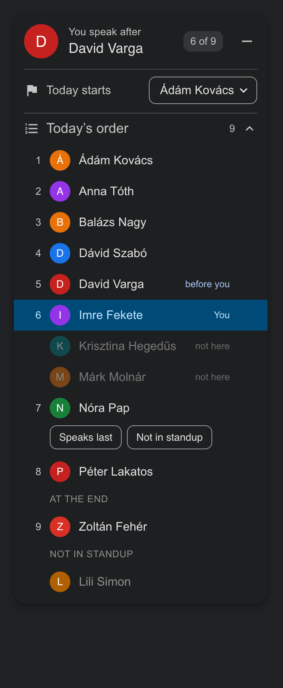

### Several meeting links for one standup

The starter is remembered for the **team**, not for one link. When you join a link the extension hasn't seen,
it looks at who is in the call: if at least 3 people and 60% of them are a team it knows, it's the same standup
and the rotation continues. A call with different people (a 1:1, another team) starts its own record.

### Minimize

Click **–** to shrink the card to a round button; click the button to open it again.


## The toolbar window

Click the extension icon (pin it from the puzzle icon first) to see:

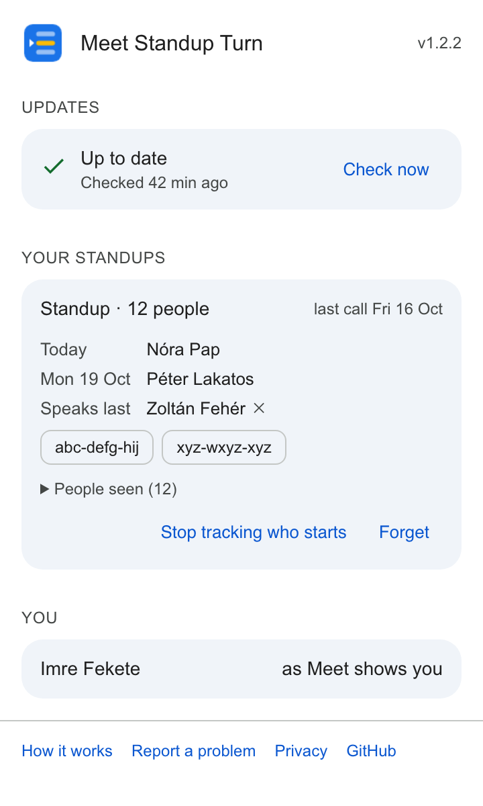

- **Updates**: up to date / update available (with the steps) / downloaded (with **Reload extension**). **Check now** checks GitHub right away.
- **Your standups**: for each team, who starts today and on the next weekday, the Meet links it used (click to open),
  the people seen. **Stop tracking who starts** clears the starter; **Forget** deletes the team.
- **You**: your name as Meet shows it.

## Update

When a new version is on GitHub, the extension icon gets a **↑** badge, and the card and the toolbar window show it:

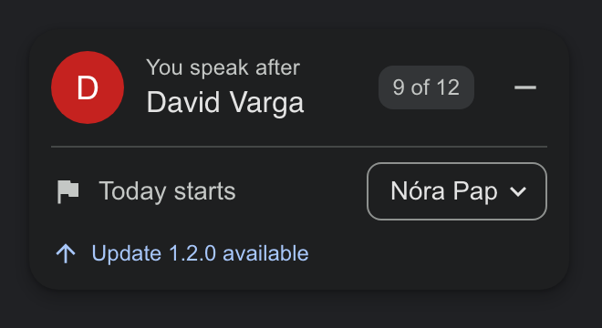

**1. Get the new files** into the same folder:

- with git:
  ```bash
  cd ~/meet-standup-turn && git pull
  ```
- without git: download [the ZIP](https://github.com/ibro-makhmudov/meet-standup-turn/archive/refs/heads/main.zip) again
  and replace the files in your existing folder (keep the folder where it is: Chrome remembers its path).

**2. Click "Reload extension"**, in the card (it notices the new files within half a minute) or in the toolbar window:

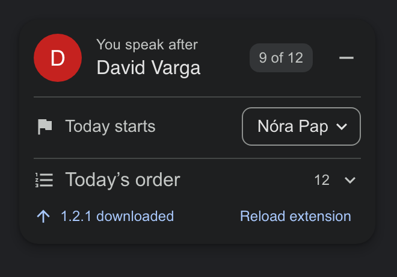 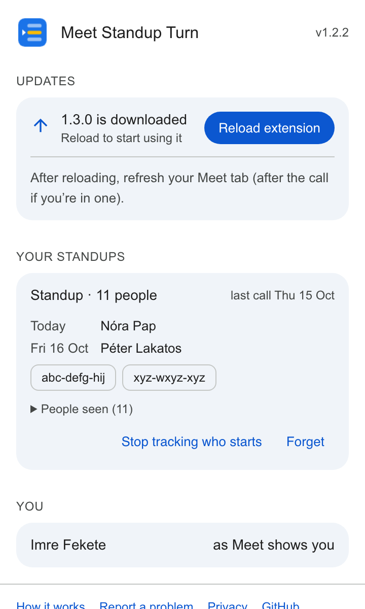

**3. Refresh the Meet tab.** If you are in a call, do it after the call (refreshing means rejoining).

The button does the same as **↻** on the extension in `chrome://extensions`, so you don't need to open that page.
(If you prefer it: Chrome doesn't open `chrome://` links from websites, so paste `chrome://extensions` into the address bar.)
Your saved data (who started, the team) is kept: it lives in Chrome, not in the folder.

## Questions

**The card doesn't appear.** Reload the Meet tab. The card only shows inside a call, not on the Meet home page
or the "Ready to join?" screen. If you just replaced the files, the extension must be reloaded too
("Reload extension" in the card, or ↻ in `chrome://extensions`).

**The People panel flashed when I joined.** That's the extension reading the names. It happens once per call.

**Someone is in the order who doesn't do standup (a guest), or the lead always goes last.** Use the exceptions:
**⋮** next to the person in Today's order → **Not in standup** or **Speaks last**.

**"Merged audio".** People joining from a meeting room device are grouped by Meet; they are counted as normal people.

**How does it notice people joining or leaving?** Every 1.5 seconds it reads Meet's participant list
(Meet keeps it in the page, hidden, once People was opened) and recalculates. The card only redraws when something changed.

**"Can't read or change site's data" in the icon's menu.** That's Chrome's wording on any site except Google Meet:
the extension only has access to meet.google.com.

**Privacy.** Nothing is sent anywhere. The extension stores only, per team, who started last, the names seen and the meeting links used,
in your browser. Its only network request reads the latest version number from this repository.
See [PRIVACY.md](PRIVACY.md).

## Develop

```bash
node --test test/*.test.js   # logic tests
./pack.sh                    # zip for the Chrome Web Store
```

`demo/index.html` is a fake Meet call for trying the card without Meet (made-up names). Serve the folder over http:

```bash
python3 -m http.server 8765   # then open http://localhost:8765/demo/index.html?open=1
```

Demo URL options: `date=2026-10-13` fakes today, `reset=1` clears saved data, `open=1` opens People,
`lazy=1` renders the list only after People is opened once (like Meet), `chat=1` starts with chat open,
`people=A,B,C` sets who is in the call, `merged=A,B` groups people under "Merged audio",
`starter=Name` presets today's starter, `talk=Name` makes Name's sound indicator move like in Meet, `link=abc-defg-hij` pretends to be another meeting link,
`order=1` opens Today's order, `exlast=A&exskip=B` creates a team with these exceptions, `rowmenu=Name` opens ⋮ for Name, `menu=1`, `min=1`, `update=1.2.1` (newer version on GitHub),
`ondisk=1.2.1` (newer files already in the folder), `clean=1` for screenshots.
